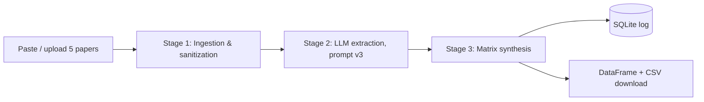

# Literature Review Comparison Tool

Streamlit app that compares up to 5 research papers (methods, findings, limitations) using Claude.

## Workflow


## Setup (macOS)
```bash
cd lit-review-tool
python3 -m venv .venv
source .venv/bin/activate
pip install -r requirements.txt
export ANTHROPIC_API_KEY="your-key"
streamlit run app.py
```
Opens at http://localhost:8501. Optional: `export CLAUDE_MODEL=<model-name>` to override the default.

## Usage
1. Paste text or upload `.txt`/`.pdf` in each Paper tab (minimum 2 papers, 200+ characters each).
2. Click **Generate Matrix**.
3. View the matrix, download CSV, or open **Run history**.

## Data storage
Every run is logged to `literature_review.db` (table `runs`: timestamp, sanitized inputs, matrix, errors).
```bash
sqlite3 literature_review.db "SELECT id, created_at FROM runs;"
```

## Testing
Follow `test_evidence.md` (5 cases, including the edge case) and fill in the results table.

## Files
- `app.py`: application
- `prompts.md`: v1 to v3 prompt iterations (v3 in use)
- `test_evidence.md`: test cases
- `requirements.txt`: dependencies

## Streamlit Cloud Deployment
1. Push this repo to GitHub.
2. Go to [share.streamlit.io](https://share.streamlit.io) → New app.
3. Set **Main file path** to `lit-review-tool/app.py`.
4. Add `ANTHROPIC_API_KEY` under **Advanced settings → Secrets**.
